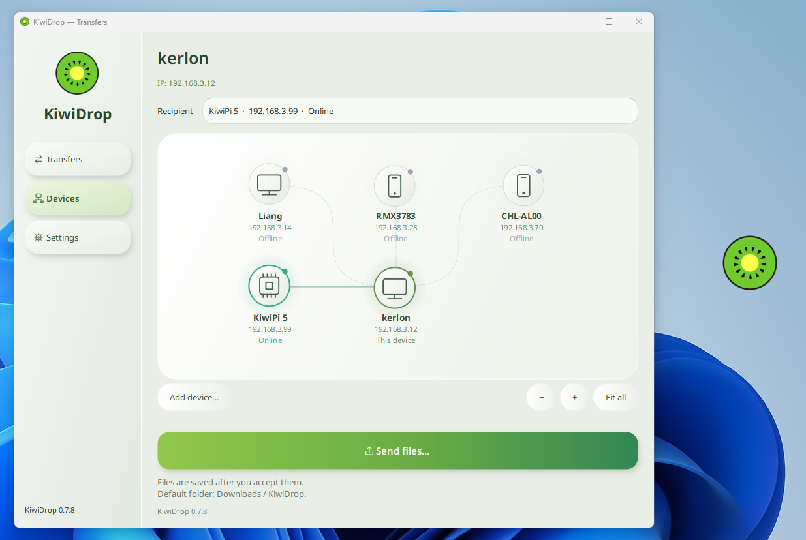
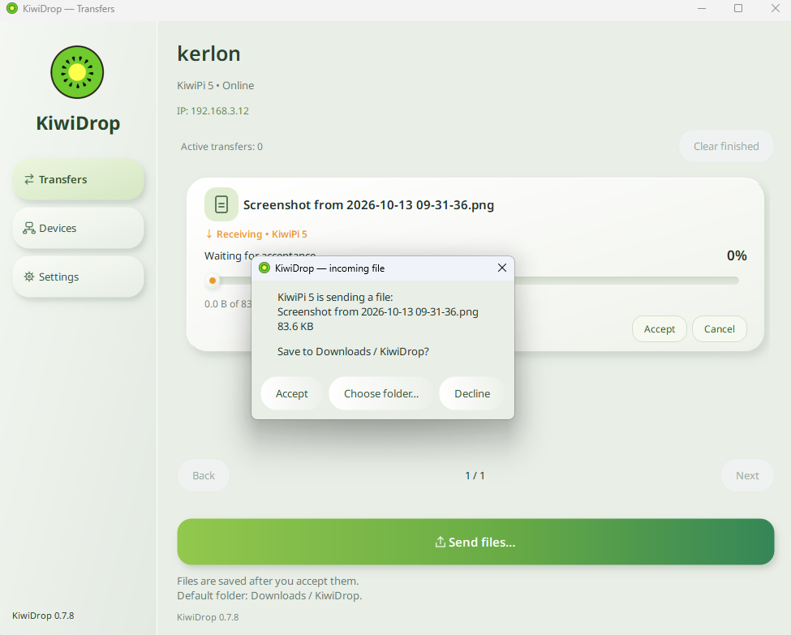

# KiwiDrop

**Test version — KiwiDrop is currently under active development and testing.**

Secure local file sharing for Windows, Linux, and Android.

**Drag files onto the floating desktop widget to send them to a paired device.** You can also send files from Windows Explorer or share them from an Android app.

[Download the latest version](https://github.com/KiwiPi-Technology/KiwiDrop/releases/latest)

Choose the standard Windows or Linux ZIP for everyday use. **Full** ZIPs include installers for sharing updates offline. The standard edition can download these later from **Settings → Download packages to update other devices**.

## Install

- **Windows:** extract the entire Windows ZIP. If needed, install Python using the included installer, then run `Install-KiwiDrop.cmd`.
- **Linux:** use **Devices → Linux device installation** in KiwiDrop on your desktop. The release includes the Linux package for supported x86_64 and ARM64 systems.
- **Android:** install the APK. Android 10 or later is required. Enable notifications and background reception to receive files.

## Pair devices

Connect both devices to the same local network. Open **Devices**, enable pairing on the receiving device, then find it or enter its IP address. Enter its four-digit code on the connecting device.

You can also connect from a PC to an Android phone: enable pairing on the phone and enter the phone's IP on the PC.

## Updates

KiwiDrop checks GitHub Releases at startup and when you select **Check for updates**. Download and installation require confirmation; paired devices and settings are preserved.

Updates can also be shared through paired devices, without internet access. Update packages are digitally signed and checked before installation.

To update Windows manually, extract the new ZIP and run `Reinstall-KiwiDrop.cmd`. Install a new Android APK over the existing app.

## Screenshots

Desktop interface shown in version 0.7.8.

### Floating desktop widget
Drag files onto the kiwi widget to send them. Its context menu provides quick access to recipients, transfers, devices, settings, and the downloads folder.

### Device map · Windows
See paired computers, phones, and boards at a glance, with their connection status and local IP addresses.

### Transfer progress · Linux
Track progress, transfer speed, and estimated time remaining. Pause or cancel a transfer, and follow its progress directly on the desktop widget.

### Incoming file · Windows
The receiving device shows who sent the file, its name, and its size. Accept it, choose a destination folder, or decline.

## Feedback

[Report an issue](https://github.com/KiwiPi-Technology/KiwiDrop/issues) with your KiwiDrop version, operating system, and steps to reproduce the problem.

