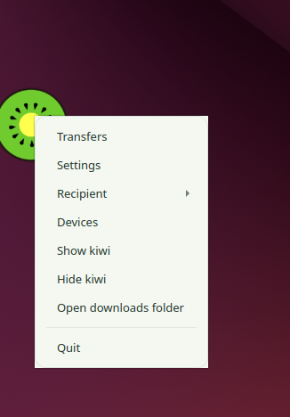
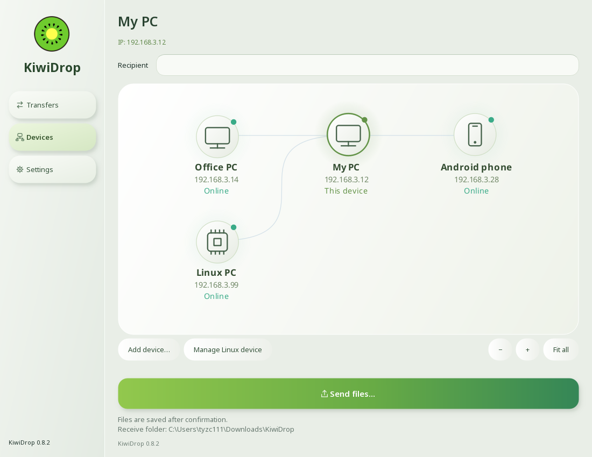
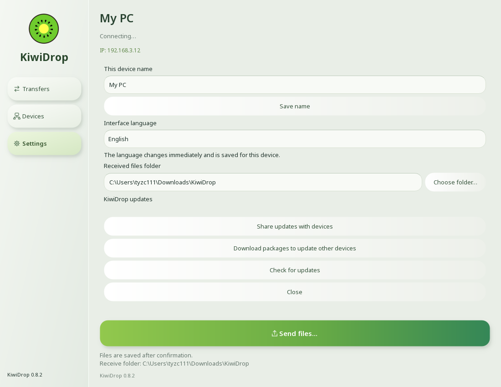
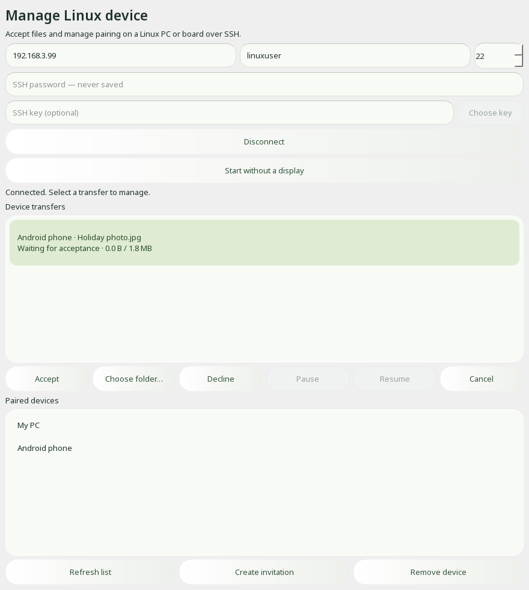
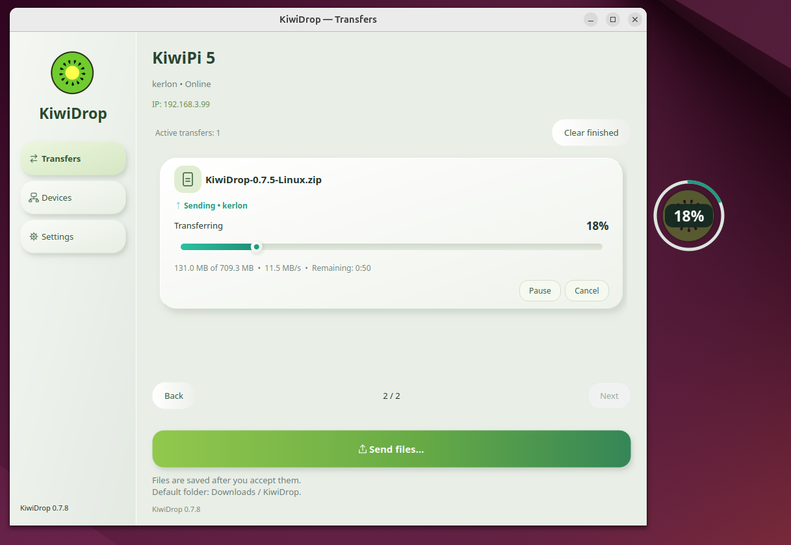

# KiwiDrop

**Test version — KiwiDrop is under active development and testing.**

Free local file sharing for Windows, Linux, and Android. **Drag files onto the floating desktop widget to send them to a paired device.** You can also send files from Windows Explorer or share them from an Android app. Files travel directly between devices on your local network.

[Download the latest version](https://github.com/KiwiPi-Technology/KiwiDrop/releases/latest)

Choose **Standard** for everyday use. **Full** includes installers for updating other devices without internet. Standard can download these packages later from Settings. Android has one edition.

## Requirements

| Platform | Requirements |
| --- | --- |
| Windows | Windows 10 (1809 or newer) or Windows 11, x64; standard 64-bit Python 3.12 or 3.13. The ZIP includes an official Python installer and offline dependencies. |
| Linux | x86_64 or ARM64; Python 3.11–3.13 with pip; glibc 2.34 or newer. The ARM64 graphical app requires glibc 2.39 or newer. |
| Android | Android 10 or newer. Allow notifications and enable background reception to receive while using other apps. |

Linux needs a graphical desktop for the floating widget. Headless reception uses systemd; installation and remote management require SSH. Ubuntu 24.04 and Debian 13 meet the listed requirements on both Linux architectures. Debian 12 meets them on x86_64; its ARM64 desktop does not meet the glibc requirement. Ubuntu on ARM64 has been tested; full Debian integration testing is pending. 32-bit and musl-based Linux systems are unsupported. Windows 7/8/8.1 and 32-bit Windows are unsupported; Windows on ARM has not been tested.

Use the same local network for pairing and transfers. Internet access is needed for GitHub updates, but paired devices can also distribute updates locally.

## Install and pair

- **Windows:** extract the entire ZIP, install the included Python if needed, then run `Install-KiwiDrop.cmd`.
- **Linux:** use **Devices → Linux device installation / invitation** on a PC. Verify the SSH host fingerprint before installation and choose a graphical app or a headless service.
- **Android:** install the APK and allow the requested notification permission.

On the recipient, enable pairing for two minutes. On the other device, find it or enter its local IP, then enter the **four-digit code** shown by the recipient. Pairing is saved for later transfers. For PC-to-Android or Android-to-Android pairing, keep background reception enabled on the phone receiving the request.

Read the [guide to local file sharing between Windows and Linux](https://kiwipi.com/blog/local-file-sharing-windows-linux/).

## Desktop features

### Floating desktop widget

Drop files onto the widget, or use its menu to choose a device and open transfers, devices, or settings.

### Device map

See paired computers, phones, and Linux boards with their local IP and connection status. Right-click a device to send a file, pair again, request an update, or remove it. Zoom and **Fit all** keep the map readable.

### Choose where received files are saved

Open **Settings → Received files folder → Choose folder**. The default is Downloads / KiwiDrop; your selection is saved on this device.

### Manage a Linux device from your PC

Open **Devices → Manage Linux device** and connect over verified SSH. View the live transfer queue, accept or decline incoming files, select a destination on the Linux device, and pause, resume, or cancel transfers. You can also manage paired devices and create pairing invitations.

This works with Linux PCs and boards, including devices without a display. KiwiDrop must be running on the Linux device; the dialog can start its headless service. Passwords are never saved. Automatic acceptance from trusted devices is optional; manual acceptance is available through this dialog.

*The three 0.8.2 screenshots show the actual application widgets with example device names and transfer data. The floating widget screenshot is from an earlier version.*

### Transfers on Linux

## Android reception

An incoming-file banner appears inside the app on every tab, with the sender, file details, and **Accept / Decline** actions. Notifications remain available outside the app. After download, open the file from its transfer card or notification. Animated progress shows background reception startup and other operations.

## Updates

KiwiDrop checks GitHub at startup and through **Settings → Check for updates**. Installation requires confirmation and preserves pairings and settings. Signed update manifests and package checksums are verified before installation.

To update without internet, enable **Share updates with devices** on a paired device with the newer installers. A PC can also request an update from the device map; the recipient confirms it. Standard users can first select **Download packages to update other devices**.

For manual updates, use `Reinstall-KiwiDrop.cmd` on Windows, the Linux installer from a PC, or install the newer Android APK over the existing app.

## Feedback

[Report an issue](https://github.com/KiwiPi-Technology/KiwiDrop/issues) with the app version, operating system, steps to reproduce, and the exact error message.

